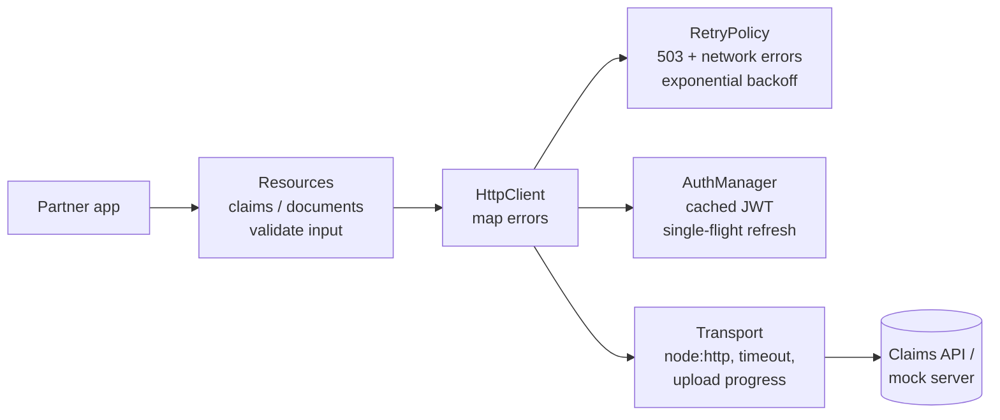
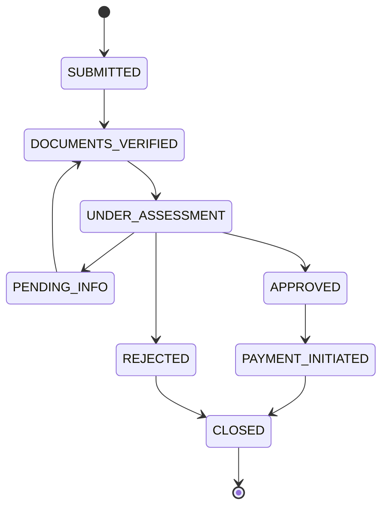

# Insurance Partner Integration SDK

A TypeScript SDK that lets insurance partners (hospitals, brokers, corporates) submit claims, upload documents and track claim status from their own Node.js applications, plus a mock API server to develop and test against.

- **`@insurance/partner-sdk`** (`packages/sdk`): zero runtime dependencies, fully typed, with client-side validation, automatic token refresh, retries with exponential backoff, typed errors, upload progress and status tracking. **[API reference and integration guide →](packages/sdk/README.md)**
- **`@insurance/mock-server`** (`packages/mock-server`): a Fastify server implementing the claims API in memory, with simulated latency and transient failures.
- **`examples/`**: three runnable integration scripts.

## Quickstart

You need **Node.js 20.6 or later**.

```bash
# 1. Install
npm install

# 2. Configure your development API key (the mock server accepts pk_test_dev_123)
cp .env.example .env

# 3. Start the mock API (leave it running)
npm run mock

# 4. In a second terminal, submit your first claim
npm run example:1
```

Expected output:

```
Submitting a claim...
Created: CLM-0001 | SUBMITTED | OUTPATIENT 15,000 THB | policy POL-123
Fetched: CLM-0001 is SUBMITTED (submitted 2026-10-27T09:00:00.000Z)

Submitting an invalid claim (no request is sent)...
Validation failed:
  - policyId: must match POL-<digits>
  - diagnosisCode: must be a valid ICD-10 code
  - amount: must be positive
```

The code behind it is short:

```ts
import { InsuranceSDK } from '@insurance/partner-sdk';

const sdk = new InsuranceSDK({
  apiKey: process.env.INSURANCE_API_KEY!, // always passed explicitly
  environment: 'sandbox',
});

const claim = await sdk.claims.create({
  policyId: 'POL-123',
  claimType: 'OUTPATIENT',
  diagnosisCode: 'J06.9',
  treatmentDate: '2024-03-15',
  amount: 15000,
  currency: 'THB',
});
```

## Examples

| Script | What it shows |
|---|---|
| `npm run example:1` | Submit a claim; handle `ValidationError` from client-side validation. |
| `npm run example:2 -- <filePath> [documentType]` | Submit a claim and upload a document with a progress bar. Try `npm run example:2 -- examples/fixtures/sample-receipt.pdf`. |
| `npm run example:3 [-- <claimId>]` | Watch a claim's status until you press Ctrl+C. It prints the `curl` command to move the claim to its next status. |

The examples read `INSURANCE_API_KEY` and `INSURANCE_BASE_URL` from `.env` and pass them to the SDK. The SDK itself never reads environment variables.

## Repository layout

```
packages/
  sdk/            @insurance/partner-sdk: the SDK (src/, test/, README.md)
  mock-server/    @insurance/mock-server: the mock API (src/, test/)
tests/integration SDK ↔ mock server end-to-end tests
examples/         integration scripts + fixtures/sample-receipt.pdf
docs/superpowers/ design spec and implementation plan
```

## Architecture

The SDK is a small pipeline. Each layer has one job and is tested on its own.



Validation rules and the claim lifecycle live in the SDK (`validation/rules.ts`), and the mock server imports them, so the client and the server always apply the same rules.

### Claim lifecycle



## Mock server

`npm run mock` starts the server on `http://localhost:4000` (configured from `.env`).

### API endpoints

| Method | Path | Auth | Notes |
|---|---|---|---|
| POST | `/api/v1/auth/token` | – | `{ apiKey }` → `{ accessToken, tokenType: 'Bearer', expiresIn }` |
| POST | `/api/v1/claims` | Bearer | 201 with the new claim (`SUBMITTED`); 400 with field errors |
| GET | `/api/v1/claims/:id` | Bearer | 404 `NOT_FOUND` for unknown ids |
| GET | `/api/v1/claims?status&page&pageSize` | Bearer | Newest first; `pageSize` ≤ 100 |
| POST | `/api/v1/claims/:id/documents` | Bearer | multipart `type` + `file`; PDF/JPEG/PNG ≤ 10 MB (413 / 415 otherwise) |
| GET | `/api/v1/claims/:id/documents` | Bearer | Document metadata only |

Errors always look like `{ "code": "...", "message": "...", "fields"?: { ... } }`, and every response carries an `x-request-id` header.

### Control endpoints (testing and demos only)

These endpoints need no auth and chaos never affects them.

```bash
# Move a claim to its next status (409 INVALID_TRANSITION lists the allowed ones)
curl -X PATCH localhost:4000/__mock/claims/CLM-0001/status \
  -H 'content-type: application/json' -d '{"status":"DOCUMENTS_VERIFIED","note":"optional"}'

# Clear all data
curl -X POST localhost:4000/__mock/reset
```

### Configuration

| Variable | Default | Meaning |
|---|---|---|
| `MOCK_PORT` | `4000` | Listen port |
| `MOCK_API_KEYS` | `pk_test_dev_123` | Comma-separated accepted API keys |
| `MOCK_JWT_SECRET` | `dev-secret-change-me` | HS256 signing secret |
| `MOCK_JWT_TTL_SEC` | `3600` | Token lifetime. Set it low (e.g. `65`) to see automatic refresh. |
| `CHAOS` | `on` | `off` disables the delay and the failures |
| `MOCK_FAILURE_RATE` | `0.1` | Fraction of `/api/v1` requests answered with 503 |
| `MOCK_DELAY_MIN_MS` / `MOCK_DELAY_MAX_MS` | `200` / `500` | Simulated latency |
| `MOCK_SEED` | unset | Seeds the random source for reproducible chaos |

## Scripts

| Script | Description |
|---|---|
| `npm test` | All unit, mock-server and integration tests (Vitest) |
| `npm run typecheck` | `tsc --noEmit` in strict mode |
| `npm run lint` | ESLint (`no-explicit-any` is an error) |
| `npm run build` | Builds the SDK to `packages/sdk/dist` (ESM + CJS + type declarations) |
| `npm run mock` | Starts the mock server with `.env` |
| `npm run example:1` / `:2` / `:3` | Runs the examples with `.env` |
