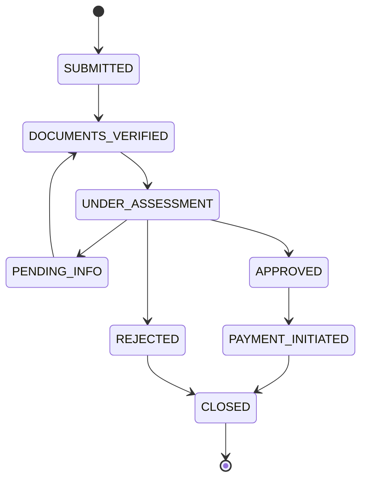

# @insurance/partner-sdk

Submit insurance claims, upload supporting documents and track claim status from your Node.js application.

- Zero runtime dependencies; Node.js 20.6 or later
- Fully typed: no `any`, with autocompletion for every option, status and error
- Checks your input before sending it, so mistakes surface immediately with field-level messages
- Handles authentication for you: it exchanges your API key for a token and refreshes it before it expires
- Retries transient failures (HTTP 503, network errors) with exponential backoff
- Reports upload progress and claim status changes

```ts
import { InsuranceSDK } from '@insurance/partner-sdk';

const sdk = new InsuranceSDK({ apiKey: process.env.INSURANCE_API_KEY!, environment: 'sandbox' });

const claim = await sdk.claims.create({
  policyId: 'POL-123',
  claimType: 'OUTPATIENT',
  diagnosisCode: 'J06.9',
  treatmentDate: '2024-03-15',
  amount: 15000,
  currency: 'THB',
});
await sdk.documents.upload(claim.id, './receipt.pdf', { type: 'medical_receipt' });
sdk.claims.onStatusChange(claim.id, (status) => console.log(`${claim.id} is now ${status}`));
```

**Contents**

- [Part A: API reference](#part-a-api-reference)
  - [`new InsuranceSDK(options)`](#new-insurancesdkoptions)
  - [`sdk.claims`](#sdkclaims)
  - [`sdk.documents`](#sdkdocuments)
  - [Errors](#errors)
  - [Types, constants and helpers](#types-constants-and-helpers)
- [Part B: Integration guide](#part-b-integration-guide)
  1. [Installation and setup](#1-installation-and-setup)
  2. [Managing credentials](#2-managing-credentials)
  3. [Configuring environments](#3-configuring-environments)
  4. [Submitting claims](#4-submitting-claims)
  5. [Uploading documents](#5-uploading-documents)
  6. [Tracking status](#6-tracking-status)
  7. [Pagination](#7-pagination)
  8. [Error handling patterns](#8-error-handling-patterns)
  9. [Testing your integration](#9-testing-your-integration)
  10. [Go-live checklist](#10-go-live-checklist)
  11. [Troubleshooting and FAQ](#11-troubleshooting-and-faq)

---

# Part A: API reference

## `new InsuranceSDK(options)`

```ts
new InsuranceSDK(options: InsuranceSDKOptions)
```

| Option | Type | Default | Description |
|---|---|---|---|
| `apiKey` | `string` | **required** | Your partner key, `pk_test_…` (sandbox) or `pk_live_…`. The SDK never reads it from the environment: pass it explicitly. |
| `environment` | `'sandbox' \| 'production'` | **required** | Selects the base URL: `http://localhost:4000` or `https://api.insurance.example.com`. |
| `baseUrl` | `string` | from `environment` | Overrides the base URL (e.g. the mock server on another port). A trailing `/` is removed. |
| `timeout` | `number` (ms) | `30000` | Timeout for each attempt, covering connect, upload and response. |
| `maxRetries` | `number` | `3` | Retries for transient failures (503 and network errors). `0` disables retries. |
| `transport` | `Transport` | `NodeTransport` | Replaces the HTTP layer. Useful in tests (see [§9](#9-testing-your-integration)). |

**Throws** `ValidationError` synchronously when options are invalid, e.g. `{ apiKey: 'required' }`, `{ apiKey: 'must start with pk_' }`, `{ environment: 'must be sandbox or production' }`, `{ timeout: 'must be a positive integer' }`, `{ maxRetries: 'must be a non-negative integer' }` or `{ baseUrl: 'must be a valid URL' }`.

The instance exposes two resources: `sdk.claims` and `sdk.documents`. Create one instance and reuse it: it caches the access token and shares it across every request.

## `sdk.claims`

### `claims.create(input)`

```ts
create(input: CreateClaimInput): Promise<Claim>
```

Submits a new claim. The SDK validates the input first, so invalid input throws `ValidationError` **without sending a request**. New claims start in status `SUBMITTED`.

| Field | Type | Rule |
|---|---|---|
| `policyId` | `string` | `POL-` followed by digits, e.g. `POL-123` |
| `claimType` | `ClaimType` | `OUTPATIENT` \| `INPATIENT` \| `DENTAL` \| `MATERNITY` \| `EMERGENCY` |
| `diagnosisCode` | `string` | ICD-10, e.g. `J06.9` (`^[A-Z]\d{2}(\.\d{1,4})?$`) |
| `treatmentDate` | `string` | `YYYY-MM-DD`, a real calendar date, not in the future (today is allowed) |
| `amount` | `number` | Greater than 0, at most 2 decimal places |
| `currency` | `Currency` | `THB` \| `USD` \| `VND` \| `SGD` |

**Throws:** `ValidationError` (client-side or server-side), `AuthError`, `NetworkError`, `ApiError`.

### `claims.get(id)`

```ts
get(id: string): Promise<Claim>
```

Fetches a claim with its current `status` and full `statusHistory`. An unknown id throws `ApiError` with `status: 404` and `code: 'NOT_FOUND'`. An empty id throws `ValidationError({ id: 'required' })`.

### `claims.list(params?)`

```ts
list(params?: ListClaimsParams): Promise<Page<Claim>>
```

| Param | Type | Default | Rule |
|---|---|---|---|
| `status` | `ClaimStatus` | all | One of the [lifecycle statuses](#6-tracking-status) |
| `page` | `number` | `1` | Integer ≥ 1 |
| `pageSize` | `number` | `20` | Integer from 1 to 100 |

Returns `{ data, page, pageSize, total, totalPages }`, newest claims first. A page beyond the last one returns `data: []`.

### `claims.onStatusChange(id, callback, options?)`

```ts
onStatusChange(
  claimId: string,
  callback: (newStatus: ClaimStatus, claim: Claim) => void | Promise<void>,
  options?: { intervalMs?: number; onError?: (error: SDKError) => void },
): () => void
```

Polls the claim and calls `callback` whenever its status differs from the last one seen. The first poll only records the current status. The method returns an **unsubscribe** function.

| Option | Default | Description |
|---|---|---|
| `intervalMs` | `5000` | Time between polls (minimum `1000`). Polls never overlap: the next one is scheduled after the previous one finishes. |
| `onError` | – | Receives errors that persist after the SDK's own retries, and errors thrown by your callback or rejected by your async callback (`code: 'CALLBACK_ERROR'`). Polling continues, **except** after an `AuthError` or a 404 `ApiError`, where it stops. |

Polling keeps the Node.js process alive until you call the unsubscribe function. **Throws** `ValidationError` synchronously for an empty `claimId` or an invalid `intervalMs`.

## `sdk.documents`

### `documents.upload(claimId, source, options)`

```ts
upload(claimId: string, source: string | Buffer | Readable, options: UploadOptions): Promise<ClaimDocument>
```

Uploads a PDF, JPEG or PNG of at most 10 MB.

| `source` | Required options | Retried on 503 / network error? |
|---|---|---|
| File path (`string`) | – (`filename` defaults to the file's name) | Yes |
| `Buffer` | `filename` | Yes |
| `Readable` stream | `filename`, `size` (bytes) | **No**: a stream can only be read once |

| Option | Type | Description |
|---|---|---|
| `type` | `DocumentType` | `medical_receipt` \| `medical_report` \| `prescription` \| `id_card` \| `other` |
| `filename` | `string` | Name sent to the API; also used to infer the content type |
| `contentType` | `string` | `application/pdf` \| `image/jpeg` \| `image/png`; inferred from the extension when omitted |
| `size` | `number` | Size in bytes (streams only) |
| `onProgress` | `(percent: number) => void` | Integer percentages that only ever increase, always ending with `100` |

All checks run before any bytes are sent. They produce `ValidationError` with fields such as `{ file: 'file not found' }`, `{ filename: 'required' }`, `{ size: 'must be at most 10 MB' }`, `{ size: 'must be greater than 0' }` and `{ contentType: 'must be one of application/pdf, image/jpeg, image/png' }`.

### `documents.list(claimId)`

```ts
list(claimId: string): Promise<ClaimDocument[]>
```

Lists the documents uploaded to a claim (metadata only).

## Errors

Every error the SDK throws extends `SDKError`, which extends `Error`. Use `instanceof` to branch on them.

| Class | When | Extra properties |
|---|---|---|
| `ValidationError` | Invalid input (checked before sending), or a 400 from the API | `fields: Record<string, string>`, e.g. `{ amount: 'must be positive' }` |
| `AuthError` | Invalid API key, or a token the API keeps rejecting after a refresh | `code: 'INVALID_API_KEY' \| 'TOKEN_EXPIRED' \| 'UNAUTHORIZED'` |
| `NetworkError` | No HTTP response: connection failure or timeout, after retries | `code: 'NETWORK_ERROR' \| 'TIMEOUT'`, `retryable`, `cause` |
| `ApiError` | Any other error response, including 503 after retries | `status`, `code` (e.g. `NOT_FOUND`, `SERVICE_UNAVAILABLE`, `FILE_TOO_LARGE`, or `HTTP_<status>` for non-JSON bodies), `body` |

All errors carry `code`, `message` and, when the API returned one, `requestId` (from the `x-request-id` header).

## Types, constants and helpers

Everything below is exported from `@insurance/partner-sdk`.

- **Types:** `Claim`, `CreateClaimInput`, `ClaimStatus`, `ClaimType`, `Currency`, `StatusHistoryEntry`, `ListClaimsParams`, `Page<T>`, `ClaimDocument`, `DocumentType`, `UploadOptions`, `UploadSource`, `StatusChangeCallback`, `StatusChangeOptions`, `Unsubscribe`, `InsuranceSDKOptions`, `Transport`, `TransportRequest`, `TransportResponse`, `ValidationResult`
- **Constants:** `CLAIM_STATUSES`, `CLAIM_TRANSITIONS` (allowed next statuses), `TERMINAL_STATUSES`, `CLAIM_TYPES`, `CURRENCIES`, `DOCUMENT_TYPES`, `ALLOWED_CONTENT_TYPES`, `MAX_DOCUMENT_BYTES`, `MAX_PAGE_SIZE`, `ENVIRONMENT_URLS`
- **Validators:** the same checks the SDK runs before each request. Use them to validate a form before submitting:
  - `validateClaim(input): ValidationResult`
  - `validateDocument({ type, contentType, size }): ValidationResult`
  - `validateListParams(params): ValidationResult`
  - `inferContentType(filename): string | undefined`
- **`maskApiKey(key)`:** `pk_test_dev_123` → `pk_test_****123`, safe to log

---

# Part B: Integration guide

## 1. Installation and setup

```bash
npm install @insurance/partner-sdk
```

The SDK requires **Node.js 20.6 or later** and works from ESM and CommonJS:

```ts
import { InsuranceSDK, ValidationError } from '@insurance/partner-sdk'; // ESM / TypeScript
```

```js
const { InsuranceSDK, ValidationError } = require('@insurance/partner-sdk'); // CommonJS
```

Type declarations are bundled, so no `@types` package is needed. For the best autocompletion, enable `"strict": true` in your `tsconfig.json`.

The SDK is for **server-side** use. Run it in your backend, never in a browser or mobile app, because it needs your API key.

## 2. Managing credentials

- **Keep keys out of code.** Load the key from an environment variable or a secret manager (AWS Secrets Manager, Vault, Doppler…) and pass it in:
  ```ts
  const apiKey = process.env.INSURANCE_API_KEY;
  if (!apiKey) throw new Error('INSURANCE_API_KEY is not set');
  const sdk = new InsuranceSDK({ apiKey, environment: 'production' });
  ```
  The SDK deliberately never reads environment variables itself. Configuration stays explicit, and two SDK instances with different keys can't collide.
- **Local development:** keep the key in a git-ignored `.env` file and load it with Node's built-in `node --env-file=.env app.js`. You don't need `dotenv`.
- **Sandbox vs production:** `pk_test_…` keys work with the sandbox, `pk_live_…` keys with production. Use a separate key per environment.
- **Never log keys.** If you need to identify a key in logs, use `maskApiKey(key)`. The SDK never includes the key in its errors.
- **Rotation:** to rotate a key, deploy the new one and restart. The SDK fetches a new token the first time it needs one. If you run several instances, roll them one at a time; the old and new keys both work during the overlap.
- **Tokens are handled for you.** The SDK exchanges the key for a 1-hour access token and refreshes it 60 seconds before expiry. If the API rejects a token early, the SDK refreshes and retries the request once. When many requests run at the same time, they share a single refresh.

## 3. Configuring environments

```ts
// Sandbox against the local mock server
const sdk = new InsuranceSDK({ apiKey, environment: 'sandbox' });

// Sandbox against a mock server on another host or port
const sdk = new InsuranceSDK({ apiKey, environment: 'sandbox', baseUrl: 'http://mock.internal:4100' });

// Production with a tighter timeout and more retries
const sdk = new InsuranceSDK({ apiKey, environment: 'production', timeout: 10_000, maxRetries: 5 });
```

- **`timeout`** applies to **each attempt**. The worst case for one call is about `(maxRetries + 1) × timeout` plus backoff delays. Choose values that fit your own request deadlines.
- **Backoff:** the waits between attempts are 200 ms, 400 ms, 800 ms, … up to 5 s, plus up to 200 ms of random jitter.
- Create **one SDK instance per API key** and share it. Creating an instance per request throws away the cached token.

## 4. Submitting claims

Map your internal data to `CreateClaimInput`:

```ts
import type { CreateClaimInput } from '@insurance/partner-sdk';

function toClaimInput(visit: HospitalVisit): CreateClaimInput {
  return {
    policyId: `POL-${visit.policyNumber}`,
    claimType: visit.admitted ? 'INPATIENT' : 'OUTPATIENT',
    diagnosisCode: visit.icd10.toUpperCase(), // e.g. 'J06.9'
    treatmentDate: visit.date.toISOString().slice(0, 10), // YYYY-MM-DD
    amount: Math.round(visit.totalCharge * 100) / 100, // at most 2 decimals
    currency: 'THB',
  };
}
```

Things to watch:

- **Dates:** `treatmentDate` must be a real date (`2024-02-30` is rejected) and must not be in the future. "Today" is your server's local date. Watch out for `toISOString()` around midnight: it converts to UTC, which can produce tomorrow's date in UTC+ time zones. Format the local date instead if that matters for you.
- **Amounts:** use the claim currency's main unit (`15000` = 15,000 THB), not minor units. Values like `150.255` are rejected; round first.
- **Validate early:** to show errors in your UI before the user submits, call `validateClaim(formData)`. It runs exactly the same checks as `create`:
  ```ts
  const result = validateClaim(formData);
  if (!result.ok) showFieldErrors(result.fields); // { policyId: 'must match POL-<digits>', ... }
  ```
- **Avoid duplicates:** `create` is not idempotent. If a call fails with a `NetworkError` after the request may have reached the server, check `claims.list()` for a matching claim before you submit again.

## 5. Uploading documents

```ts
// From a file on disk (recommended: the size is known and retries are safe)
await sdk.documents.upload(claim.id, '/data/scans/receipt-123.pdf', { type: 'medical_receipt' });

// From memory, e.g. a file received by your own upload endpoint
await sdk.documents.upload(claim.id, buffer, { type: 'id_card', filename: 'id-front.jpg' });

// From a stream, e.g. straight from object storage
const object = await s3.getObject({ Bucket, Key });
await sdk.documents.upload(claim.id, object.Body as Readable, {
  type: 'medical_report',
  filename: 'report.pdf',
  size: object.ContentLength!,
});
```

- **Limits:** PDF, JPEG or PNG, between 1 byte and 10 MB. The SDK infers the content type from the filename extension; pass `contentType` if your filenames have none.
- **Progress:** `onProgress` receives whole percentages that only go up, ending with `100`, which makes it safe to drive a progress bar directly:
  ```ts
  await sdk.documents.upload(claim.id, path, {
    type: 'medical_receipt',
    onProgress: (percent) => job.updateProgress(percent),
  });
  ```
- **Retries:** paths and Buffers are retried on 503 or network errors. Streams are **not**, because a stream can only be read once. If you need retries for a stream, buffer it first (fine for files of 10 MB or less) or write it to a temporary file.

## 6. Tracking status



`PENDING_INFO` means the insurer needs more information. Upload the requested documents, and the claim returns to `DOCUMENTS_VERIFIED`. `CLOSED` is the only final status (`TERMINAL_STATUSES`).

```ts
import { TERMINAL_STATUSES } from '@insurance/partner-sdk';

const stop = sdk.claims.onStatusChange(
  claim.id,
  async (status, claim) => {
    await db.claims.update(claim.id, { status });
    if (status === 'PENDING_INFO') await notifyStaff(claim.id, claim.statusHistory.at(-1)?.note);
    if ((TERMINAL_STATUSES as readonly string[]).includes(status)) stop();
  },
  { intervalMs: 30_000, onError: (error) => logger.warn({ code: error.code, requestId: error.requestId }, 'poll failed') },
);
```

- **Choosing an interval:** claims move over hours or days, so 30–60 seconds is plenty for a background worker. Use short intervals (a few seconds) only when a user is watching.
- **Missed intermediate steps:** polling only sees the latest status. If a claim moves twice between polls, the callback fires once, with the newest status. Use `claim.statusHistory` (every step, with timestamps and notes) when you need every transition.
- **Errors:** transient failures are retried inside each poll. What still fails goes to `onError` and polling carries on. After an `AuthError` (bad key) or a 404 (claim not found), polling stops, since retrying can't help.
- **Your callback:** it may be `async`. If it throws or its promise rejects, the error goes to `onError` with `code: 'CALLBACK_ERROR'` and polling continues. It is not awaited, so the next poll doesn't wait for it. Always pass `onError`: without it, these errors are dropped.
- **Shutdown:** active polling keeps the process alive. Call every unsubscribe function on shutdown:
  ```ts
  const subscriptions = new Set<() => void>();
  process.on('SIGTERM', () => subscriptions.forEach((stop) => stop()));
  ```
- **Many claims:** each subscription polls on its own. For hundreds of open claims, one periodic `claims.list({ status })` sweep is cheaper than hundreds of subscriptions.

## 7. Pagination

```ts
import type { Claim, ClaimStatus } from '@insurance/partner-sdk';

async function* allClaims(status?: ClaimStatus): AsyncGenerator<Claim> {
  for (let page = 1; ; page++) {
    const result = await sdk.claims.list({ status, page, pageSize: 100 });
    yield* result.data;
    if (page >= result.totalPages) return;
  }
}

for await (const claim of allClaims('PENDING_INFO')) {
  console.log(claim.id);
}
```

Results are newest first. Claims created while you page through can shift items onto later pages, so de-duplicate by `id` if you need an exact snapshot.

## 8. Error handling patterns

```ts
import { ApiError, AuthError, NetworkError, ValidationError } from '@insurance/partner-sdk';

try {
  await sdk.claims.create(input);
} catch (error) {
  if (error instanceof ValidationError) {
    // Fix the input: show error.fields next to the form fields. Retrying unchanged input won't help.
    return { status: 422, errors: error.fields };
  }
  if (error instanceof AuthError) {
    // Configuration problem: wrong or revoked key. Alert the team; don't retry in a loop.
    logger.error({ code: error.code }, 'insurance API authentication failed');
    throw error;
  }
  if (error instanceof NetworkError) {
    // The SDK already retried. Queue the work for later.
    await queue.add('submit-claim', input, { delay: 60_000 });
    return { status: 202 };
  }
  if (error instanceof ApiError) {
    // 404 NOT_FOUND, 409 INVALID_TRANSITION, 503 SERVICE_UNAVAILABLE after retries, ...
    logger.error({ status: error.status, code: error.code, requestId: error.requestId }, error.message);
    throw error;
  }
  throw error; // a bug in your own code
}
```

**What the SDK already retries for you:** HTTP 503 and network errors (up to `maxRetries`, default 3, with backoff), plus one token refresh after a 401. Don't wrap SDK calls in your own immediate retry loop; queue the work and retry later instead.

**Showing `ValidationError.fields` to users:** the keys match `CreateClaimInput` property names, so you can map them straight to form fields. Messages are short and lowercase (`'must be positive'`), so you can prefix them with your own label: `Amount ${fields.amount}`.

**Support requests:** include `error.requestId` when contacting the insurer. It identifies the exact request in their logs.

## 9. Testing your integration

### Against the mock server

The repository includes a mock server with the same API:

```bash
cp .env.example .env
npm run mock                     # http://localhost:4000, accepts pk_test_dev_123
CHAOS=off npm run mock           # no artificial latency or 503s
MOCK_SEED=42 npm run mock        # the same "random" failures on every run
MOCK_JWT_TTL_SEC=65 npm run mock # tokens expire quickly, so you can see refresh at work
```

Move claims through the lifecycle with the control endpoint. No auth is needed:

```bash
curl -X PATCH localhost:4000/__mock/claims/CLM-0001/status \
  -H 'content-type: application/json' -d '{"status":"DOCUMENTS_VERIFIED"}'
curl -X POST localhost:4000/__mock/reset   # clear all data between test runs
```

Invalid moves return `409 INVALID_TRANSITION` with the `allowed` next statuses.

### Unit tests without a server

Pass a custom `transport` to answer requests in memory:

```ts
import { InsuranceSDK, type Transport } from '@insurance/partner-sdk';

const transport: Transport = {
  async send(req) {
    if (req.url.endsWith('/auth/token')) {
      return { status: 200, headers: {}, body: { accessToken: 'test', tokenType: 'Bearer', expiresIn: 3600 } };
    }
    if (req.method === 'POST' && req.url.endsWith('/claims')) {
      return { status: 201, headers: {}, body: { ...JSON.parse(req.body as string), id: 'CLM-0001', status: 'SUBMITTED' } };
    }
    return { status: 404, headers: {}, body: { code: 'NOT_FOUND', message: 'not found' } };
  },
};

const sdk = new InsuranceSDK({ apiKey: 'pk_test_unit', environment: 'sandbox', transport });
```

A transport resolves for every HTTP status and rejects only with `NetworkError`, for example `new NetworkError('down')` to exercise your retry handling.

## 10. Go-live checklist

- [ ] A `pk_live_…` key is stored in your secret manager, not in code or `.env` files in production
- [ ] `environment: 'production'` (or the production `baseUrl` your insurer gave you)
- [ ] `timeout` × (`maxRetries` + 1) fits inside your own request deadlines
- [ ] Each `ValidationError`, `AuthError`, `NetworkError` and `ApiError` is handled as in [§8](#8-error-handling-patterns); `AuthError` raises an alert
- [ ] Logs include `error.code` and `error.requestId`, never the API key
- [ ] Failed submissions are queued and retried later, with a duplicate check (see [§4](#4-submitting-claims))
- [ ] Poll intervals suit production volumes (30 s or more for background work)
- [ ] Every `onStatusChange` subscription is unsubscribed on shutdown
- [ ] One SDK instance is shared per process

## 11. Troubleshooting and FAQ

| Symptom | Cause | Fix |
|---|---|---|
| `ValidationError { apiKey: 'required' }` at startup | The key wasn't passed; the SDK doesn't read env vars | Pass `apiKey: process.env.INSURANCE_API_KEY`, and check that `.env` is loaded (`--env-file=.env`) |
| `AuthError` `INVALID_API_KEY` | The key is wrong, revoked, or for another environment | Check the key and environment. On the mock server, the key must be listed in `MOCK_API_KEYS` |
| `AuthError` `TOKEN_EXPIRED` | The API still rejected the token after a refresh, which points to clock or secret problems | Check the server clock; on the mock server, don't change `MOCK_JWT_SECRET` while clients are running |
| `NetworkError` `NETWORK_ERROR` | The API is unreachable | Check `baseUrl` and connectivity; for local work, is `npm run mock` running? |
| `NetworkError` `TIMEOUT` | No response within `timeout` | Increase `timeout`, or check the API's status |
| `ApiError` 503 `SERVICE_UNAVAILABLE` | The service is still failing after all retries | Queue the work and retry later; increase `maxRetries` if the outages are brief |
| `ValidationError { size: 'must be at most 10 MB' }` / `ApiError` 413 `FILE_TOO_LARGE` | The file is over 10 MB | Compress the PDF or scan at a lower resolution |
| `ValidationError { contentType: ... }` / `ApiError` 415 `UNSUPPORTED_MEDIA_TYPE` | Not a PDF, JPEG or PNG, or the extension is missing | Convert the file, or pass `contentType` explicitly |
| `ApiError` 409 `INVALID_TRANSITION` (mock control endpoint) | That move isn't allowed by the lifecycle | Use one of the statuses in the response's `allowed` list |
| The process doesn't exit | An `onStatusChange` subscription is still active | Call the function `onStatusChange` returned |
| `onStatusChange` skipped a status | Several changes happened between two polls | Read `claim.statusHistory` for every step, or poll more often |

**Does the SDK work in the browser?** No. It's built for Node.js and needs your secret API key, which must never reach a browser.

**Is `create` safe to retry?** Not blindly. Retries after 503 are safe, because the request was rejected, and the SDK already performs them. After a `NetworkError`, the request may have reached the server, so check for the claim before creating it again.
